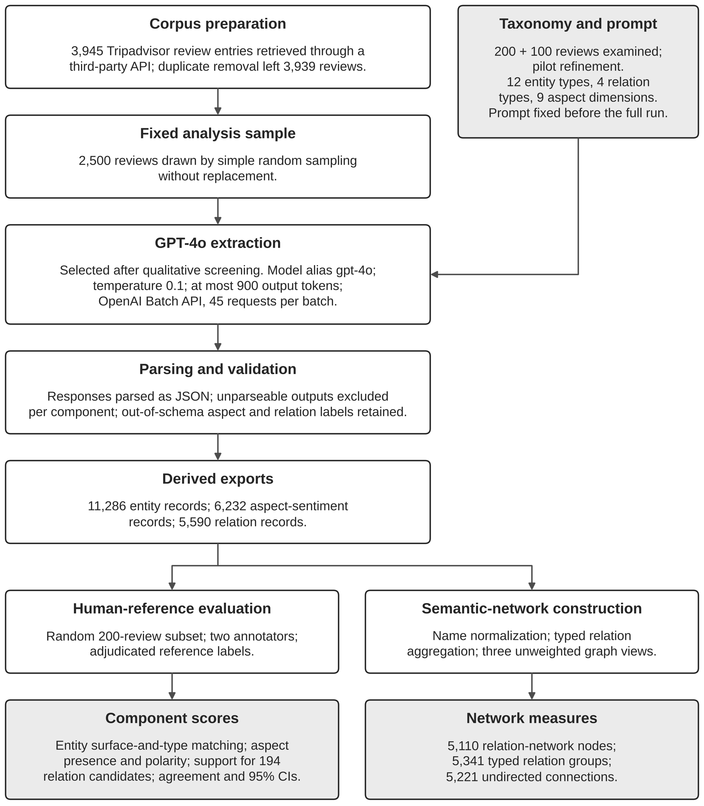
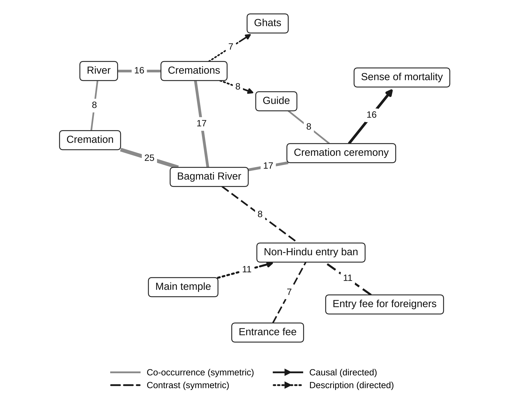

# Adapting LLM-SC to Living Sacred Heritage: Domain-Specific Extraction, Semantic Networks and Human Evaluation on Pashupatinath Temple Reviews

<div align="center">

[](https://arxiv.org/abs/2610.35685)
[](#-methodology--pipeline)
[](#-abstract)
[](https://github.com/pantpujan017)

</div>

---

## 📄 Paper

| Resource | Link |
|---|---|
| 📑 Preprint | [https://arxiv.org/abs/2610.35685](https://arxiv.org/abs/2610.35685) |
| 💻 Code & derived data | [github.com/pantpujan017/Pashupatinath-LLM-SC-](https://github.com/pantpujan017/Pashupatinath-LLM-SC-) |
| 🧾 Extraction prompt | [`taxonomy/extraction_prompt.txt`](taxonomy/extraction_prompt.txt) (also in Appendix A of the paper) |
| 🌐 Site | [ria-frontend.vercel.app](https://ria-frontend.vercel.app) |

---

## 👥 Authors

| Name | Affiliation | Contact |
|---|---|---|
| **Pujan Pant** * | Herald College Kathmandu, University of Wolverhampton, Nepal | pantpujan017@gmail.com |
| **Sagar Newpane** | Herald College Kathmandu, University of Wolverhampton, Nepal | sagarnewpane@icloud.com |
| **Hari Sitaula** | Dept. of Mathematical Sciences, Montana Technological University, USA | hsitaula@mtech.edu |
| **Manish Sakhakarmy** * | ASI Industrial, Billings, MT, USA | sakhakarmym@gmail.com |

\* Corresponding authors.

---

## 📝 Abstract

Large language model (LLM) pipelines can turn visitor reviews into structured data, but generic schemes may miss rituals, sacred spaces, cultural restrictions and emotionally mixed experiences at living sacred heritage sites. We adapted the **LLM–Social Computing (LLM-SC)** framework to **Pashupatinath Temple, Nepal**, by specifying a **12-type entity taxonomy** (four original LLM-SC types plus eight sacred-heritage types), **four relation types** and **nine aspect-sentiment dimensions** in a GPT-4o extraction prompt. The prompt was applied to a fixed random sample of **2,500 English-language Tripadvisor reviews** from a processed corpus of 3,939.

The exports contain **11,286 entity**, **6,232 aspect-sentiment** and **5,590 relation** records. The eight added sacred-heritage types account for **64.8%** of entity records. We evaluated the output against an adjudicated two-annotator reference for **200 reviews**, component by component. The contribution is a culturally grounded, domain-specific adaptation with component-wise human evaluation and explicit reproducibility and generalization limits.

> **Key Findings:**
> - The eight sacred-heritage entity types are used heavily: **7,308 of 11,286** entity records (64.8%). `ritual` (1,741) and `spiritual_emotion` (1,462) are the most frequent added types.
> - **Entity extraction (provisional):** micro-precision 41.0%, recall 21.8%, **micro-F1 28.4%** (95% CI 25.9–31.0) under strict surface-and-type matching.
> - **Aspect sentiment:** aspect-presence F1 **53.6%**, polarity agreement on co-present aspects **79.4%**, end-to-end (aspect + polarity) F1 **42.6%**.
> - **Relations:** human adjudication supported **153 of 194** first-listed relation candidates (**78.9%**). This is a candidate-level rate, not relation precision or recall.
> - The resulting semantic network has **5,110 relation-network nodes**, **5,341 typed relation groups** and **5,221 undirected connections**.
> - This study makes **no claim** that GPT-4o beats other models or that the adaptation transfers to other sites. See [Limitations](#-limitations).

---

## 🏗️ Methodology & Pipeline



*Workflow of the domain-adaptive LLM-SC pipeline and its two analysis branches. Shaded boxes are the design input (taxonomy and prompt) and the reported outputs.*

| Stage | What was done |
|---|---|
| **Corpus** | 3,945 Tripadvisor reviews of Pashupatinath Temple retrieved through a third-party API. Duplicate removal left **3,939** reviews (2008–2026). |
| **Sample** | **2,500** reviews drawn by simple random sampling without replacement. |
| **Taxonomy and prompt** | 200 reviews examined, then 100 more to refine definitions. Final taxonomy and prompt were fixed before the full run, and not changed afterwards. |
| **Extraction** | GPT-4o (`gpt-4o` alias), temperature 0.1, max 900 output tokens, OpenAI Batch API, 45 requests per batch. Strict JSON output. |
| **Parsing** | Responses parsed as JSON. Unparseable outputs excluded per component. Out-of-schema labels kept and flagged, not corrected. |
| **Human evaluation** | 200-review random subset, two annotators, adjudicated reference. Bootstrap 95% CIs (10,000 resamples over reviews). |
| **Network** | Name normalization, typed relation aggregation and three unweighted graph views built with NetworkX. |

### Taxonomy

Four entity types come from the original LLM-SC configuration and eight were added for sacred heritage.

| Entity type | Origin | Records | Share |
|---|---|---:|---:|
| `ritual` | Added | 1,741 | 15.4% |
| `scenic_spot` | Retained | 1,642 | 14.5% |
| `spiritual_emotion` | Added | 1,462 | 13.0% |
| `sacred_space` | Added | 1,425 | 12.6% |
| `problem` | Retained | 1,270 | 11.3% |
| `cultural_rule` | Added | 1,064 | 9.4% |
| `facility_service` | Retained | 876 | 7.8% |
| `religious_actor` | Added | 798 | 7.1% |
| `sacred_object` | Added | 493 | 4.4% |
| `dual_valence` | Added | 220 | 1.9% |
| `general_sentiment` | Retained | 190 | 1.7% |
| `festival_event` | Added | 105 | 0.9% |
| **Total** | | **11,286** | **100%** |

- **Relation types (4):** `co_occurrence`, `causal`, `description`, `contrast`
- **Aspect-sentiment dimensions (9):** `service`, `facility`, `environment`, `ritual_experience`, `spiritual_authenticity`, `access_fairness`, `sacred_atmosphere`, `crowd_management`, `cultural_sensitivity`
- **Polarity:** positive / neutral / negative, with a score from 0.0 to 1.0

Two of the added types need a note. `spiritual_emotion` is an emotional state the *reviewer* felt (awe, peace, grief), not one attributed to the site. `dual_valence` is an experience the reviewer describes as positive and negative at the same time, such as a cremation described as both heartbreaking and transcendent.

---

## 📊 Results

### Human-reference evaluation (200 reviews)

| Component | Measure | Value (95% CI) |
|---|---|---|
| Entities *(provisional)* | Micro-precision | 41.0% (37.7–44.4) |
| | Micro-recall | 21.8% (19.5–24.1) |
| | Micro-F1 | 28.4% (25.9–31.0) |
| | Macro-F1 (12 types) | 26.5% (23.0–30.2) |
| | F1 when type is ignored | 35.4% (32.6–38.1) |
| Aspect sentiment | Aspect-presence F1 | 53.6% (49.8–57.4) |
| | Conditional polarity accuracy | 79.4% (74.6–84.0) |
| | End-to-end F1 (aspect + polarity) | 42.6% (38.7–46.6) |
| | Macro-F1 (pos / neutral / neg) | 41.6% (37.4–45.7) |
| Relations *(first-listed candidates only)* | Supported by the review | 153 / 194 = 78.9% (73.1–84.5) |
| | Supported and correctly typed | 106 / 194 = 54.6% (47.7–61.5) |

Entity scores use exact normalized text and type matching, because the export has no character offsets. They are not character-span F1.

### Inter-annotator agreement

| Task | Agreement | Cohen's κ |
|---|---|---|
| Entity type (where both marked a span) | 82.0% | 0.80 |
| Aspect presence | 91.9% | 0.80 |
| Aspect polarity (both marked present) | 82.3% | 0.73 |
| Relation existence | 80.4% | 0.38 |
| Relation type (both accepted) | 67.4% | 0.55 |

Entity span agreement before adjudication was lower: pairwise F1 of 38.9% on exact span and type.

### Corpus-level extraction coverage (2,500 reviews)

| Component | Reviews with output | Coverage | Records |
|---|---:|---:|---:|
| Entities | 2,485 | 99.4% | 11,286 |
| Aspect sentiment | 2,487 | 99.5% | 6,232 |
| Relations | 2,433 | 97.3% | 5,590 |

Coverage means a review has at least one record. It does not say the records are correct.

### Semantic network



*Every pair of concepts linked by at least seven relation records (13 pairs among 12 nodes). Edge labels give the number of relation records. Edges are model-generated and were not all individually validated.*

| Measure | Value |
|---|---:|
| Nodes in relation network | 5,110 |
| Typed relation groups | 5,341 |
| Undirected connections | 5,221 |
| Average degree | 2.043 |
| Density | 0.000400 |
| Average clustering coefficient | 0.01337 |
| Transitivity | 0.01583 |
| Connected components | 800 |
| Largest component | 3,269 nodes (63.97%) |

The graphs represent what the model extracted. They do not verify real-world causal mechanisms, and highly connected nodes are structural hubs, not validated causes.

A post hoc duplicate-handling check (4 corpus reviews removed, 2,499 sampled reviews, no new inference) changed most counts by one or two. It added one connected component (800 → 801).

---

## 📦 Repository Structure

```
Pashupatinath-LLM-SC-/
├── README.md
├── LICENSE
├── images/
│   ├── workflow.png                 # Figure 1: pipeline
│   └── semantic_network.png         # Figure 2: top concept pairs
├── data/
│   ├── README.md                    # Column descriptions
│   ├── entity_mentions.csv
│   ├── aspect_sentiments.csv
│   └── relations.csv
├── taxonomy/
│   ├── extraction_prompt.txt
│   └── taxonomy_specification.md
├── src/
│   └── batch_extraction.py
└── analysis/
    ├── graph_counts.py
    └── figure2.py
```

| Path | Contents |
|---|---|
| [`data/entity_mentions.csv`](data/entity_mentions.csv) | 11,286 entity records (12 types) |
| [`data/aspect_sentiments.csv`](data/aspect_sentiments.csv) | 6,232 aspect-sentiment records (9 aspects) |
| [`data/relations.csv`](data/relations.csv) | 5,590 relation records |
| [`data/README.md`](data/README.md) | Column descriptions for the three files |
| [`taxonomy/extraction_prompt.txt`](taxonomy/extraction_prompt.txt) | The prompt sent to GPT-4o (Appendix A of the paper) |
| [`taxonomy/taxonomy_specification.md`](taxonomy/taxonomy_specification.md) | Entity types, relation types and aspect labels |
| [`src/batch_extraction.py`](src/batch_extraction.py) | Extraction script (OpenAI Batch API) |
| [`analysis/graph_counts.py`](analysis/graph_counts.py) | Recomputes the network counts in Table 6 of the paper |
| [`analysis/figure2.py`](analysis/figure2.py) | Redraws Figure 2 of the paper |

The three data files join on `review_id`.

---

## 🚀 Quick Start

You need Python 3 with pandas, NetworkX and matplotlib. The paper used Python 3.12, pandas 3.0.5 and NetworkX 3.6.1.

```bash
pip install pandas networkx matplotlib
python analysis/graph_counts.py data/
python analysis/figure2.py data/relations.csv figure2.png
```

`graph_counts.py` prints the node and edge counts reported in the paper (5,110 relation-network nodes, 5,341 typed edge groups, 5,221 undirected connections, and so on). `figure2.py` draws every pair of concepts linked by at least seven relation records.

### Extraction script

`src/batch_extraction.py` shows how the model outputs were produced. It reads a CSV of reviews with `review_id` and `text_clean` columns, sends each review to GPT-4o with the prompt in `taxonomy/extraction_prompt.txt`, and saves each response, raw and parsed, to `llm_raw_outputs.jsonl`. To run it, install `openai`, `pandas` and `tqdm`, and replace `API_KEY` in the script with your own OpenAI key.

The review texts used in the study are not included, so the script cannot rebuild the released files on its own. Section 3.3.3 of the paper describes how the responses were parsed and exported.

---

## 🔒 Data Availability & Ethics

**Released:** derived entity, aspect-sentiment and relation records, the taxonomy specification, the extraction prompt and the analysis code. The records contain pseudonymous review keys, review metadata (year, period, trip type, star rating), entity names and types, aspect labels, polarities and scores, and relation endpoints and types. No reviewer usernames or profile information are included. Review IDs are pseudonymous keys (`R00001` to `R02491`), and a third party's personal name found in 5 entity rows is replaced with `[NAME REDACTED]`. Entity names are short phrases from the reviews, so a distinctive phrase could still be matched to its source review by searching for it.

**Not released:**
- Raw review texts. They came from Tripadvisor through a third-party API, and the authors have not established reuse or redistribution rights.
- Supporting quotations, evidence strings and relation descriptions generated during extraction.
- Raw GPT-4o responses.

The authors make no claim of Tripadvisor authorization for the data source, and no legal conclusion is drawn. The study analyzed publicly posted reviews with no recruitment of or contact with people, so IRB approval and informed consent were not applicable.

---

## ⚠️ Limitations

These are covered in full in Section 5.5 of the paper. The main ones:

- **One site, one language, one platform.** English-language Tripadvisor reviews of a single temple. Results may not transfer.
- **Small human reference.** 200 of 2,500 reviews, annotated by two of the paper's authors. Overlap with the reviews used to design the taxonomy was not tracked.
- **Entity scores are provisional.** The evaluated entity export is a fixed snapshot, and the available code does not regenerate it from raw model responses.
- **Relation validation is candidate-level.** Only the first-listed relation per review was judged, so it supports a support rate but not relation precision, recall or F1. Annotators agreed only fairly on relation existence (κ = 0.38).
- **No model comparison.** Other models were screened qualitatively only. The paper does not claim GPT-4o is better than any alternative or than the original LLM-SC setup.
- **Partial reproducibility.** The `gpt-4o` alias was used without recording the dated snapshot, the model is closed, and raw responses are not released as a frozen set.
- **No live-system evaluation.** Monitoring use cases are motivation only. Retrieval, latency and operational impact were not tested.

---

## 📜 License

| Part | License |
|---|---|
| Code in `src/` and `analysis/` | MIT |
| Taxonomy and prompt in `taxonomy/` | CC BY 4.0 |
| Files in `data/` | No licence granted |

See [`LICENSE`](LICENSE) for details.

---

## 📚 Citation

If you use this work, please cite:

```bibtex
@article{pant2026llmsc,
  title   = {Adapting LLM-SC to Living Sacred Heritage: Domain-Specific Extraction,
             Semantic Networks and Human Evaluation on Pashupatinath Temple Reviews},
  author  = {Pant, Pujan and Newpane, Sagar and Sitaula, Hari and Sakhakarmy, Manish},
  year    = {2026},
  note    = {Preprint},
  url     = {https://arxiv.org/abs/2610.35685}
}
```

---

## 🙏 Acknowledgments

This research received no external funding. GPT-4o (OpenAI, `gpt-4o` alias) was the extraction model. ChatGPT and Claude were used to draft and refine selected manuscript passages and to prepare plotting code and evaluation-statistics code. The authors reviewed and edited all output and take full responsibility for the content.

---

## ✉️ Contact

Questions about the paper or repository: **Pujan Pant** (pantpujan017@gmail.com) or **Manish Sakhakarmy** (sakhakarmym@gmail.com).

<div align="center">
  <i>Pashupatinath Temple is part of the Kathmandu Valley UNESCO World Heritage property.</i>
</div>
